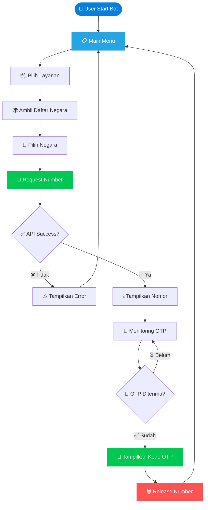

<!-- ═══════════════════════════════════════════════════════════════ -->
<!--                  FREEOTP BOT — README v2                        -->
<!--              Mobile-First • Responsive • UI/UX Pro              -->
<!-- ═══════════════════════════════════════════════════════════════ -->

<a id="top"></a>

<div align="center">


<a href="https://www.rizaldev.cloud/freeotp">
  
</a>

<br/>


<br/>


</div>

<br/>

<!-- ═══════════════════════════════════════════════════════════════ -->
<!--                        CTA CARDS                                -->
<!-- ═══════════════════════════════════════════════════════════════ -->

<div align="center">

### 🌐 Akses Cepat

<a href="https://www.rizaldev.cloud/freeotp">
  
</a>
&nbsp;
<a href="https://www.rizaldev.cloud/freeotp">
  
</a>
&nbsp;
<a href="https://www.rizaldev.cloud">
  
</a>

</div>

<br/>


<!-- ═══════════════════════════════════════════════════════════════ -->
<!--                        TABLE OF CONTENTS                        -->
<!-- ═══════════════════════════════════════════════════════════════ -->

<div align="center">

## 📑 Daftar Isi

<sub>Klik untuk langsung menuju section</sub>

</div>

<div align="center">

[🎯 Tentang](#-tentang-project) • [✨ Fitur](#-fitur-utama) • [🛠️ Tech Stack](#%EF%B8%8F-tech-stack) • [🔌 API](#-provider-api) • [📂 Struktur](#-struktur-project) • [⚙️ Instalasi](#%EF%B8%8F-instalasi-pterodactyl) • [🤖 Perintah](#-perintah-bot) • [🔄 Alur](#-alur-sistem-otp) • [🛡️ Security](#%EF%B8%8F-security--protection) • [🧰 Troubleshooting](#-troubleshooting) • [👨‍💻 Developer](#-developer)

</div>

<br/>


<!-- ═══════════════════════════════════════════════════════════════ -->
<!--                      ABOUT / INTRO                              -->
<!-- ═══════════════════════════════════════════════════════════════ -->

<a id="tentang-project"></a>
<div align="center">

## 🎯 Tentang Project

</div>

> 💡 **FREEOTP BOT** adalah bot Telegram otomatis untuk **mendapatkan nomor virtual**, **menerima kode OTP**, **mengelola nomor aktif**, dan **memantau aktivitas OTP** menggunakan **FREEOTP API**.

<br/>

<div align="center">

| 🚀 **Fast** | 🔐 **Secure** | 📱 **Responsive** |
|:---:|:---:|:---:|
| Request nomor instan | Auto OTP real-time | UI Telegram friendly |

</div>

<br/>

<!-- ═══════════════════════════════════════════════════════════════ -->
<!--                          FITUR UTAMA                            -->
<!-- ═══════════════════════════════════════════════════════════════ -->

<a id="fitur-utama"></a>
<div align="center">

## ✨ Fitur Utama

</div>

<details open>
<summary><b>📱 Core Features</b> — klik untuk expand</summary>

<br/>

| 🎨 | Fitur | Keterangan |
|:---:|:---|:---|
| 📱 | **Request Number** | Meminta nomor virtual otomatis |
| 🌍 | **Multi Country** | Memilih negara berdasarkan API |
| 📦 | **Multi Service** | Memilih layanan yang tersedia |
| 🔐 | **Auto OTP** | Monitoring OTP otomatis |
| 🔄 | **Change Number** | Mengganti nomor aktif |
| 🌎 | **Change Country** | Mengganti negara |
| 🗑️ | **Release Number** | Melepaskan nomor |

</details>

<details>
<summary><b>📊 User & Analytics</b> — klik untuk expand</summary>

<br/>

| 🎨 | Fitur | Keterangan |
|:---:|:---|:---|
| 📄 | **Get File** | Export nomor aktif ke TXT |
| 📊 | **Statistics** | Statistik provider |
| 📜 | **OTP History** | Riwayat OTP |
| 👤 | **User Profile** | Profil pengguna |
| 🏆 | **Leaderboard** | Peringkat pengguna |

</details>

<details>
<summary><b>🎁 Premium & Reward</b> — klik untuk expand</summary>

<br/>

| 🎨 | Fitur | Keterangan |
|:---:|:---|:---|
| 🎁 | **Referral** | Sistem referral |
| ⭐ | **Premium** | Sistem paket premium |

</details>

<details>
<summary><b>🛡️ Admin Tools</b> — klik untuk expand</summary>

<br/>

| 🎨 | Fitur | Keterangan |
|:---:|:---|:---|
| 🛡️ | **Admin Panel** | Panel administrasi |
| 📢 | **Broadcast** | Mengirim pesan massal |
| 🔧 | **Maintenance** | Mengaktifkan maintenance mode |

</details>

<br/>

<!-- ═══════════════════════════════════════════════════════════════ -->
<!--                        TECH STACK                               -->
<!-- ═══════════════════════════════════════════════════════════════ -->

<a id="️-tech-stack"></a>
<div align="center">

## 🛠️ Tech Stack


</div>

<br/>

<!-- ═══════════════════════════════════════════════════════════════ -->
<!--                       PROVIDER API                              -->
<!-- ═══════════════════════════════════════════════════════════════ -->

<a id="provider-api"></a>
<div align="center">

## 🔌 Provider API

### FREEOTP API — Official Integration

<a href="https://nokosproxy.riezallofficial.workers.dev">
  
</a>

</div>

<br/>

<details open>
<summary><b>⚙️ Konfigurasi Provider</b></summary>

<br/>

| 🔧 | Setting | Value |
|:---:|:---|:---|
| 🏢 | Provider | FREEOTP |
| 🔓 | Authentication | Public API |
| 🔑 | API Key | Tidak diperlukan menurut dokumentasi |
| 📤 | Request Format | JSON |
| 📥 | Response Format | JSON |
| 🔒 | Protocol | HTTPS |
| 🔗 | Connection | REST API |

</details>

<details open>
<summary><b>📡 Daftar Endpoint</b></summary>

<br/>

| Method | Endpoint | Fungsi |
|:---:|:---|:---|
|  | `/api/services` | Daftar layanan |
|  | `/api/countries` | Daftar negara |
|  | `/api/request_number` | Request nomor |
|  | `/api/my_numbers` | Nomor aktif |
|  | `/api/release_number` | Lepas nomor |
|  | `/api/latest_otp` | OTP terbaru |
|  | `/api/my_otps` | Riwayat OTP |
|  | `/api/otp` | Live OTP Feed |
|  | `/api/stats/detailed` | Statistik provider |

</details>

<details>
<summary><b>📥 Contoh Request Number</b></summary>

<br/>

**Request:**
```http
POST /api/request_number
Content-Type: application/json

{
  "service": "WhatsApp",
  "country": "Indonesia"
}
```

**Response:**
```json
{
  "success": true,
  "number": "6281234567890",
  "id": "transaction_id"
}
```

</details>

<details>
<summary><b>🔐 Contoh Cek OTP</b></summary>

<br/>

**Request:**
```http
GET /api/latest_otp?number=6281234567890
```

**Response:**
```json
{
  "success": true,
  "has_otp": true,
  "otp_code": "123456"
}
```

</details>

<br/>

<!-- ═══════════════════════════════════════════════════════════════ -->
<!--                     STRUKTUR PROJECT                            -->
<!-- ═══════════════════════════════════════════════════════════════ -->

<a id="struktur-project"></a>
<div align="center">

## 📂 Struktur Project

</div>

```bash
NOKOS-MURAH/
│
├── 📁 node_modules/
│
├── 📄 .env              # Environment variables
├── 📄 .gitignore        # Git ignore rules
├── 📄 package.json      # Project dependencies
├── 📄 README.md         # Dokumentasi
│
├── 📄 config.js         # Konfigurasi bot
├── 📄 database.js       # Handler database
├── 📄 api.js            # Integrasi FREEOTP API
├── 📄 index.js          # Entry point utama
│
└── 📄 otp.js            # Handler OTP logic
```

> 💡 **Note:** Struktur dapat berbeda mengikuti versi source code. **Jangan hapus file** yang dibutuhkan project.

<br/>

<!-- ═══════════════════════════════════════════════════════════════ -->
<!--                        INSTALASI                                -->
<!-- ═══════════════════════════════════════════════════════════════ -->

<a id="️-instalasi-pterodactyl"></a>
<div align="center">

## ⚙️ Instalasi Pterodactyl

</div>

<details open>
<summary><b>1️⃣ Persiapan</b></summary>

<br/>

Pastikan kamu memiliki:

- ✅ Panel **Pterodactyl**
- ✅ **Telegram Bot Token** — dari [@BotFather](https://t.me/BotFather)
- ✅ **Telegram User ID** untuk admin
- ✅ **Node.js versi 22**
- ✅ **File source code** FREEOTP Bot

</details>

<details>
<summary><b>2️⃣ Upload Source Code</b></summary>

<br/>

1. Buka **panel Pterodactyl**
2. Pilih **server bot**
3. Masuk ke menu **Files**
4. **Upload ZIP** project
5. **Extract ZIP**
6. Pastikan `package.json`, `index.js`, dan `.env` berada di **direktori utama**

</details>

<details>
<summary><b>3️⃣ Konfigurasi Environment</b></summary>

<br/>

Buat/edit file **`.env`**:

```env
# ========================
# TELEGRAM BOT
# ========================
BOT_TOKEN=MASUKKAN_TOKEN_BOT
ADMIN_ID=MASUKKAN_TELEGRAM_ID

# ========================
# FREEOTP PROVIDER
# ========================
OTP_API_BASE_URL=https://nokosproxy.riezallofficial.workers.dev

# ========================
# OTP GROUP
# ========================
OTP_GROUP_ID=

# ========================
# DATABASE
# ========================
DATABASE_PATH=./database.json
```

| Variable | Fungsi |
|:---|:---|
| `BOT_TOKEN` | Token Telegram Bot |
| `ADMIN_ID` | Telegram ID admin utama |
| `OTP_API_BASE_URL` | URL provider FREEOTP |
| `OTP_GROUP_ID` | ID grup notifikasi OTP |
| `DATABASE_PATH` | Lokasi database lokal |

> ⚠️ **Penting:** Pertahankan konfigurasi tambahan yang sudah ada pada `.env`. Jangan menghapus environment variable yang masih digunakan source code.

</details>

<details>
<summary><b>4️⃣ Install Dependencies</b></summary>

<br/>

Masuk ke menu **Console** Pterodactyl, lalu jalankan:

```bash
npm install
```

Tunggu hingga proses instalasi selesai.

</details>

<details>
<summary><b>5️⃣ Menjalankan Bot</b></summary>

<br/>

```bash
npm start
```

Jika konfigurasi benar, bot akan terhubung ke Telegram dan **siap digunakan** ✅

</details>

<details>
<summary><b>6️⃣ Startup Configuration</b></summary>

<br/>

Pastikan **Startup Command** menggunakan:

```bash
npm start
```

Pastikan **egg** menggunakan **Node.js 22** yang kompatibel dengan project.

</details>

<br/>

<!-- ═══════════════════════════════════════════════════════════════ -->
<!--                      PERINTAH BOT                               -->
<!-- ═══════════════════════════════════════════════════════════════ -->

<a id="perintah-bot"></a>
<div align="center">

## 🤖 Perintah Bot

</div>

<details open>
<summary><b>👤 User Commands</b></summary>

<br/>

| Command | Fungsi |
|:---|:---|
| `/start` | Membuka menu utama |
| `/menu` | Menampilkan menu |
| `/profile` | Melihat profil |
| `/referral` | Informasi referral |
| `/history` | Riwayat OTP |
| `/numbers` | Nomor aktif |
| `/help` | Bantuan |

</details>

<details>
<summary><b>🛡️ Admin Commands</b></summary>

<br/>

| Command | Fungsi |
|:---|:---|
| `/admin` | Membuka admin panel |
| `/broadcast` | Broadcast pengguna |
| `/stats` | Statistik bot |
| `/maintenance` | Maintenance mode |

</details>

> 💡 Perintah di atas merupakan dokumentasi menu yang dituju. Ketersediaannya mengikuti implementasi source code.

<br/>

<!-- ═══════════════════════════════════════════════════════════════ -->
<!--                       FLOW SISTEM                               -->
<!-- ═══════════════════════════════════════════════════════════════ -->

<a id="alur-sistem-otp"></a>
<div align="center">

## 🔄 Alur Sistem OTP

</div>



<br/>

<!-- ═══════════════════════════════════════════════════════════════ -->
<!--                        SECURITY                                 -->
<!-- ═══════════════════════════════════════════════════════════════ -->

<a id="️-security--protection"></a>
<div align="center">

## 🛡️ Security & Protection

</div>

> 🔒 **Keamanan merupakan bagian penting dari sistem.**

<details open>
<summary><b>✅ Yang Harus Dilakukan</b></summary>

<br/>

- 🔐 Gunakan **validasi input** pengguna
- ⏱️ Gunakan **timeout** untuk request API
- 🚨 Tangani **error provider** dengan benar
- 🚧 Batasi request agar tidak terjadi **spam**
- 🛡️ Lindungi perintah admin dengan `ADMIN_ID`

</details>

<details open>
<summary><b>❌ Yang Harus Dihindari</b></summary>

<br/>

- 🚫 Jangan membagikan **`.env`**
- 🚫 Jangan mempublikasikan **`BOT_TOKEN`**
- 🚫 Jangan memasukkan token ke **repository publik**
- 🚫 Jangan menyimpan data sensitif tanpa perlindungan

</details>

> ⚠️ **PENTING:** Jika token Telegram pernah bocor atau masuk ke ZIP publik, **segera revoke** dan buat token baru melalui [@BotFather](https://t.me/BotFather).

<br/>

<!-- ═══════════════════════════════════════════════════════════════ -->
<!--                     TROUBLESHOOTING                             -->
<!-- ═══════════════════════════════════════════════════════════════ -->

<a id="troubleshooting"></a>
<div align="center">

## 🧰 Troubleshooting

</div>

<details>
<summary><b>❌ Bot tidak bisa dijalankan</b></summary>

<br/>

```bash
npm install
npm start
```

Pastikan **Node.js** sesuai dengan versi yang dibutuhkan.

</details>

<details>
<summary><b>🔑 BOT_TOKEN Invalid</b></summary>

<br/>

- Periksa token pada `.env`
- Pastikan tidak ada **spasi tambahan**
- Pastikan token **belum di-revoke** di BotFather

</details>

<details>
<summary><b>🌐 Provider tidak merespons</b></summary>

<br/>

Periksa koneksi server dan URL API:

```bash
https://nokosproxy.riezallofficial.workers.dev/api/services
```

</details>

<details>
<summary><b>🌍 Negara tidak muncul</b></summary>

<br/>

Pastikan nama layanan berasal dari respons `/api/services`, kemudian gunakan nama layanan tersebut untuk mengambil daftar negara.

</details>

<details>
<summary><b>📵 OTP tidak masuk</b></summary>

<br/>

Pastikan nomor masih aktif dan provider mendukung layanan serta negara yang dipilih.

</details>

<details>
<summary><b>💾 Database Error</b></summary>

<br/>

Periksa permission direktori project dan lokasi penyimpanan database.

</details>

<br/>

<!-- ═══════════════════════════════════════════════════════════════ -->
<!--                    API DOCUMENTATION                            -->
<!-- ═══════════════════════════════════════════════════════════════ -->

<div align="center">

## 📚 API Documentation

Developer dapat mempelajari integrasi FREEOTP melalui dashboard resmi:

<a href="https://www.rizaldev.cloud/freeotp">
  
</a>

<br/><br/>

**Dokumentasi mencakup:**

`Daftar Layanan` • `Daftar Negara` • `Request Nomor` • `Nomor Aktif` • `Release Nomor` • `Latest OTP` • `OTP History` • `Live OTP Feed` • `Statistik Provider` • `Contoh Integrasi JS / PHP / cURL`

</div>

<br/>

<!-- ═══════════════════════════════════════════════════════════════ -->
<!--                        DEVELOPER                                -->
<!-- ═══════════════════════════════════════════════════════════════ -->

<a id="developer"></a>
<div align="center">

## 👨‍💻 Developer


### **RIZALDEV**

*Developer & API Integration*

<br/>

<a href="https://www.rizaldev.cloud">
  
</a>
<a href="https://www.rizaldev.cloud/freeotp">
  
</a>

</div>

<br/>

<!-- ═══════════════════════════════════════════════════════════════ -->
<!--                       FOOTER                                    -->
<!-- ═══════════════════════════════════════════════════════════════ -->

<div align="center">


### ⭐ **FREEOTP BOT — NOKOS MURAH** ⭐

*Powered by FREEOTP API*

**Developed with ❤️ by [Rizaldev](https://www.rizaldev.cloud)**

<br/>


<br/><br/>

<a href="#top">
  
</a>

</div>